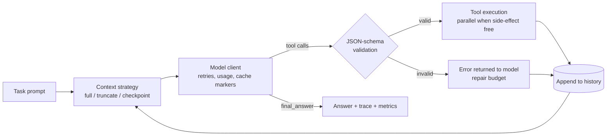
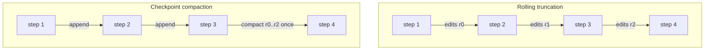

# agent-harness


A runtime for tool-using LLM agents that measures what harness design does to cost and latency, down to
cache reads and writes. It runs against the Anthropic Messages API, any OpenAI-compatible server
(OpenAI, DeepSeek, vLLM, Ollama) and an offline mock, using only the Python standard library.

| Measured on 6-question HotpotQA sessions | Result |
|---|---|
| Rolling context truncation vs. full history, Claude Sonnet 5.5 | 4.5x cost; cache hit rate 79.8% -> 16.3% |
| Checkpoint compaction vs. rolling truncation, Claude Sonnet 5.5 | prefix breaks -86%, cache hits 16.3% -> 74.0%, cost -62% |
| Prompt caching on vs. off, Claude Haiku 5.5 | cost -60% |
| vLLM prefix caching on vs. off, Qwen3-8B on one L40 | 91.7% KV-cache hits, 2.6x throughput, -63% latency |
| 16 vs. 1 concurrent sessions on vLLM | 7.5x throughput, -87% cost per session |

Full tables and setup: [RESULTS.md](RESULTS.md).

## Agent loop



Each step records tokens, cache reads, cache writes, latency, tool errors and whether the prompt was an
extension of the previous one. Cost is computed from the provider's reported usage, with cache writes
and cache reads priced at their own rates.

## Checkpoint compaction

Prompt caches only reuse a prefix that is byte-identical to an earlier request. Rolling truncation edits an
older tool result every step, so every step pays to rebuild the cache from that message on. Checkpoint
compaction lets old results accumulate untouched and compacts them in one batch once they pass a size
threshold, so the prompt is append-only between batches.



The harness counts prefix breaks for every trajectory. In the runs above, checkpoint compaction broke the
prefix exactly once per compaction, 1.4 times per Sonnet session against 10.4 for rolling truncation.

## Components

| File | Contents |
|---|---|
| `harness/llm.py` | Anthropic and OpenAI-compatible clients, backoff on 408/429/5xx, cache breakpoints, usage parsing, mock client |
| `harness/tools.py` | Tool registry and JSON-schema validation of arguments |
| `harness/agent.py` | Agent loop, repair handling, parallel tool calls, text-mode tool calling, context strategies, prefix-break counting |
| `harness/context.py` | Rolling truncation and summarization |
| `harness/router.py` | Cascade and step-level escalation from a cheap model to a strong one |
| `harness/metrics.py` | Cost model, latency percentiles, cache hit and write rates, bootstrap confidence intervals |
| `harness/runner.py` | Runs a benchmark under a config and writes traces and a summary |
| `benchmarks/` | HotpotQA, HotpotQA-Session and GSM8K, each with its tools and official-style scoring |

## Usage

```bash
python3 -m unittest discover tests
python3 scripts/run_bench.py --config configs/baseline.toml --bench gsm8k --n 20 --dry-run
```

`--dry-run` replaces every model with the offline mock. It checks the pipeline; its scores are not
meaningful.

For real models, copy `.env.example` to `.env`, fill in the keys and load them into the shell. Model ids
and prices are in `configs/models.toml`.

```bash
python3 scripts/run_bench.py --config configs/cache/sonnet_checkpoint8k.toml --bench hotpotqa_session --n 20
python3 scripts/compare.py results/<baseline run> results/<other run>
```

`scripts/run_cache_experiment.sh` reruns the hosted-model experiment.
`scripts/run_selfhost_experiment.sh` reruns the vLLM experiment against a server given by
`VLLM_BASE_URL` and `VLLM_API_KEY`.

## Layout

```text
harness/          runtime
benchmarks/       benchmark adapters, tools, scorers
configs/          model registry and prices, run configurations
scripts/          experiment runners, comparison and report scripts
tests/            offline unit tests
results_summary/  per-run metrics behind RESULTS.md
```
